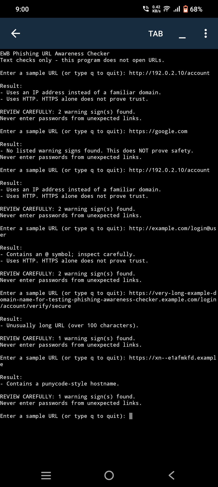
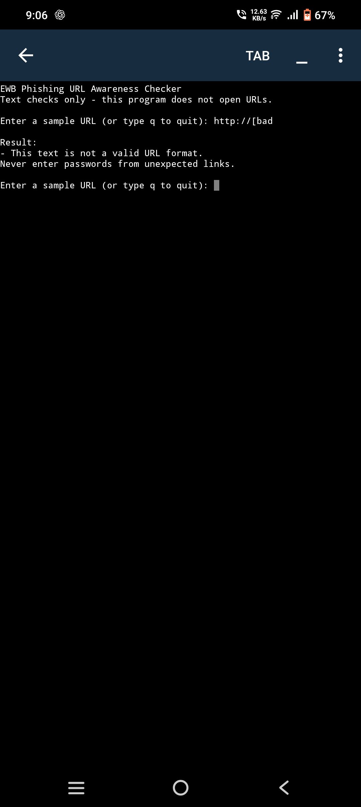

# Phishing URL Awareness Checker

A beginner-friendly Python cybersecurity mini project that checks URL text for selected warning signs commonly associated with suspicious links. It is designed for phishing awareness and learning; it is not a website reputation service or a guarantee that a link is safe.

## Project Overview

The program asks the user to enter a URL, checks the text locally, displays any matching warning signs, and then allows another URL to be entered.

Type `q`, `quit`, or `exit` to close the program.

**Privacy and Safety:** The program does not open, visit, or send entered URLs anywhere. It only inspects the text provided by the user.

## Features

The checker looks for these six indicators:

1. An `@` symbol in the URL text.
2. A URL longer than 100 characters.
3. An IPv4 address used as the hostname.
4. Five or more hostname segments (subdomains/labels).
5. A punycode-style hostname containing `xn--`.
6. The use of plain HTTP instead of HTTPS.

It also handles empty input, URLs where a hostname cannot be identified, and malformed URL text.

If none of the listed indicators is found, it displays a reminder that this does not prove the URL is safe.

## Requirements

- Python 3.10 or later is recommended.
- No third-party Python packages are required.
- Uses Python standard-library modules.

## How to Run

1. Download or clone this repository.
2. Open a terminal in the project folder.
3. Run the following command:

```bash
python phishing_checker.py
```

On some systems, use:

```bash
python3 phishing_checker.py
```

4. Enter a URL when prompted.
5. Enter another URL to continue, or type `q` to quit.

### Running on Android

The project can also be run in a Python IDE for Android, such as Pydroid 3.

1. Open `phishing_checker.py` in the app.
2. Tap the Run button.
3. Enter a sample URL.

## Sample Checks

| Input | Expected Observation |
|---|---|
| `https://google.com` | No listed warning signs; this does not prove safety. |
| `http://192.0.2.10/account` | IP-address and HTTP warnings. |
| `http://example.com/login@user` | @-symbol and HTTP warnings. |
| Long example URL | Long-URL warning. |
| `https://xn--e1afmkfd.example` | Punycode-style hostname warning. |
| `http://[bad` | Invalid URL format message; program continues accepting input. |

See `test_samples.md` in the repository for the test log.

## Screenshots

## Screenshots

The following screenshots show actual execution of the program:

## Screenshots

### Sample Run


### Test Results


## Limitations

- The checker uses simple text-based rules and can produce false positives or miss suspicious links.
- It does not check domain age, website reputation, DNS records, certificates, redirects, page content, or malware.
- A URL with no listed warning signs may still be malicious.
- HTTPS does not guarantee that a website is trustworthy.
- Never enter passwords, payment details, or personal information on an unexpected or untrusted website.

## Learning Outcomes

- Practised Python functions, loops, conditionals, regular expressions, URL parsing, and user input/output.
- Learned to recognise several URL patterns that deserve closer inspection.
- Understood why a simple warning checker cannot certify a website as safe.

## License

This project is provided for educational use. Add a specific open-source license only if you intend to publish the project under its terms.

## Author
Harsh Singh 
